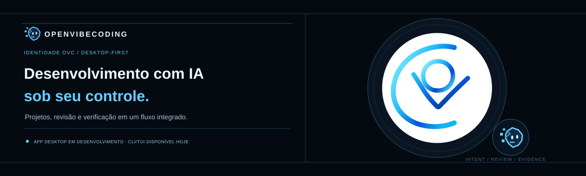

<p align="center">
  
</p>

<p align="center">
  <strong>Programação com IA, no seu terminal — sem abrir mão do controle.</strong><br>
  Peça uma tarefa. Entenda o que será alterado. Revise. Aprove. Verifique o resultado.
</p>

<p align="center">
  <a href="https://github.com/iagoluch/OpenVibeCoding/releases/latest">⬇️ Baixar para Windows, Linux ou macOS</a>
  &nbsp;·&nbsp;
  <a href="https://github.com/iagoluch/OpenVibeCoding">⭐ Apoiar com uma estrela</a>
</p>

<p align="center">
  <a href="README.md">🇧🇷 Português</a> ·
  <a href="README.en.md">🇺🇸 English</a> ·
  <a href="README.es.md">🇪🇸 Español</a> ·
  <a href="README.zh-CN.md">🇨🇳 简体中文</a>
</p>

<p align="center">
  
  
  
</p>

---

## O que é o OpenVibeCoding?

O **OpenVibeCoding (OVC)** é um agente de programação com inteligência artificial que trabalha na pasta do seu projeto e usa ferramentas reais de desenvolvimento.

Em vez de apenas responder com trechos de código, ele pode explorar os arquivos, entender a estrutura do projeto, propor alterações, pedir sua aprovação e executar comandos para conferir o que aconteceu. O histórico das conversas e das tarefas fica salvo localmente.

**Você continua no comando:** o OVC mostra mudanças para revisão antes de aplicá-las e não deve dizer que algo funcionou sem observar o resultado.

## O que dá para fazer com ele?

- **Entender um projeto existente:** ler arquivos, procurar código, consultar instruções do projeto e inspecionar o estado do Git.
- **Trabalhar no código:** propor a criação, substituição, movimentação ou remoção de arquivos e apresentar as alterações para revisão.
- **Conferir o resultado:** executar comandos autorizados, incluindo comandos de testes, e observar a saída e o código de retorno.
- **Retomar de onde parou:** manter conversas, contexto e registros das tarefas em armazenamento local.
- **Automatizar tarefas compatíveis:** usar fluxos de navegador com Playwright ou integrações de desktop quando estiverem configurados e autorizados.
- **Escolher a IA:** conectar provedores diferentes, endpoints compatíveis com a API da OpenAI ou modelos locais.

## Como funciona na prática?

<ol>
  <li><strong>Você descreve a tarefa.</strong> Por exemplo: “Investigue por que este teste falha e proponha uma correção pequena”.</li>
  <li><strong>O OVC investiga.</strong> Ele consulta os arquivos e as instruções relevantes do projeto.</li>
  <li><strong>Você revisa a mudança.</strong> Veja o diff proposto e aprove ou rejeite a operação. A aprovação vale para aquela operação, não para tudo que vier depois.</li>
  <li><strong>Você confere o resultado.</strong> Quando autorizado, o agente executa a verificação e informa a saída observada.</li>
</ol>

O exemplo acima descreve o fluxo de trabalho; não é uma demonstração gravada nem uma promessa de que toda tarefa será resolvida automaticamente.

## Instale o OVC

**Você não precisa instalar Go para usar os binários prontos.** Baixe uma versão para o seu sistema na página de [Releases](https://github.com/iagoluch/OpenVibeCoding/releases/latest). Os arquivos publicados incluem o programa e um arquivo de checksums SHA-256.

### Windows (opção simples)

1. Abra [Releases — baixar OVC](https://github.com/iagoluch/OpenVibeCoding/releases/latest).
2. Baixe `openvibecoding-windows-amd64.zip` para a maioria dos PCs Windows com processador Intel ou AMD. Em dispositivos Windows com processador ARM, escolha `openvibecoding-windows-arm64.zip`.
3. Extraia o ZIP para uma pasta.
4. Abra o PowerShell nessa pasta e execute:

```powershell
.\ovc.exe --setup
```

O assistente ajuda a escolher um provedor de IA e configurar a credencial. Depois, abra seu projeto:

```powershell
.\ovc.exe --workspace "C:\caminho\do\seu\projeto"
```

Troque o caminho de exemplo pela pasta real do projeto. Esses comandos executam o programa a partir da pasta em que você extraiu o arquivo.

### Linux

Na página de [Releases](https://github.com/iagoluch/OpenVibeCoding/releases/latest), baixe `openvibecoding-linux-amd64.tar.gz` para a maioria dos PCs Linux ou `openvibecoding-linux-arm64.tar.gz` para sistemas ARM64. No terminal, entre na pasta onde o arquivo foi baixado e execute, usando o nome do arquivo correspondente:

```sh
tar -xzf openvibecoding-linux-amd64.tar.gz
./ovc --setup
./ovc --workspace "/caminho/do/seu/projeto"
```

### macOS

Baixe na página de [Releases](https://github.com/iagoluch/OpenVibeCoding/releases/latest):

- `openvibecoding-darwin-arm64.tar.gz` para Macs com Apple Silicon.
- `openvibecoding-darwin-amd64.tar.gz` para Macs com processador Intel.

No terminal, entre na pasta de download, extraia o arquivo correspondente e inicie o assistente:

```sh
tar -xzf openvibecoding-darwin-arm64.tar.gz
./ovc --setup
./ovc --workspace "/caminho/do/seu/projeto"
```

No Mac Intel, substitua o nome do arquivo pelo pacote `darwin-amd64`.

### Quer instalar o comando no PATH?

O repositório também contém instaladores que baixam o pacote correto, verificam o SHA-256 e instalam o comando no diretório do usuário. Essa opção requer Git para obter os scripts; **não requer Go**.

Linux/macOS:

```sh
git clone https://github.com/iagoluch/OpenVibeCoding.git
cd OpenVibeCoding
bash scripts/install.sh
```

Windows (PowerShell):

```powershell
git clone https://github.com/iagoluch/OpenVibeCoding.git
cd OpenVibeCoding
./scripts/install.ps1 -AddToPath
```

Depois de instalar pelo script, feche e abra novamente o terminal. No Windows, se a política de execução bloquear o instalador, execute `powershell -ExecutionPolicy Bypass -File scripts/install.ps1 -AddToPath` dentro da pasta do repositório.

### Primeiro uso: configure a IA

Execute `ovc --setup` para abrir o assistente de configuração. Ele apresenta opções de provedores, pode detectar servidores locais do Ollama e LM Studio e permite importar credenciais compatíveis já configuradas no OpenCode.

Depois, abra a pasta do projeto em que deseja trabalhar:

```sh
ovc --workspace "/caminho/do/seu/projeto"
```

No Windows, usando um binário que você extraiu, execute `.\ovc.exe --workspace "C:\caminho\do\seu\projeto"`.

**Sobre custos:** o OVC é código aberto e há opções de provedores com planos gratuitos ou modelos locais. Isso não significa que toda IA seja gratuita: cada provedor define suas próprias cotas, cobranças e condições, que podem mudar. O assistente de configuração mostra as alternativas disponíveis na versão instalada.

## Qual modelo de IA preciso usar?

Nenhum modelo específico é obrigatório. O OVC oferece adaptadores nativos para OpenAI, Anthropic/Claude e Google Gemini, além de endpoints compatíveis com a API da OpenAI. Isso permite conectar serviços como DeepSeek, Kimi, Qwen, Mistral e servidores locais compatíveis.

Você escolhe o provedor e o modelo conforme disponibilidade, orçamento e necessidade. Os nomes, limites e planos podem mudar nos serviços externos.

## Segurança e limites, sem maquiagem

- As ferramentas comuns de arquivos ficam restritas ao workspace configurado e aplicam exclusões para caminhos sensíveis.
- As alterações de arquivo são mostradas para revisão e precisam de aprovação individual antes de serem aplicadas.
- No Linux, a execução padrão de comandos usa Bubblewrap e falha de forma fechada quando o isolamento necessário não está disponível.
- **No Windows e no macOS, o OVC não possui o mesmo sandbox de processos integrado.** Comandos que exigem esse confinamento são recusados. A opção explícita `--allow-unsandboxed-shell` permite execução com os privilégios da sua conta no sistema e não é isolamento.
- Automação de navegador e desktop depende de configuração e permissões da plataforma. Ações externas nem sempre são reversíveis.

Leia [Segurança e limites de execução](docs/security.md) para entender os detalhes antes de habilitar shell ou automação.

## Documentação e ajuda

| Quero... | Consulte |
| --- | --- |
| Começar, configurar um provedor e conhecer os comandos | [Guia do usuário](docs/guide.md) |
| Entender como o projeto foi organizado | [Arquitetura](docs/architecture.md) |
| Conhecer proteções e limitações reais | [Segurança](docs/security.md) |
| Configurar navegador ou ações de desktop | [Automação](docs/automation.md) |
| Executar testes e diagnosticar problemas | [Testes e diagnóstico](docs/testing.md) |
| Ver o código-fonte da página de apresentação | [Site](site/) |

## Gostou da ideia? Ajude o projeto a chegar a mais gente.

Se o OVC parece útil para você, **[abra a página do OpenVibeCoding e clique em ⭐ Star](https://github.com/iagoluch/OpenVibeCoding)**. A estrela ajuda outras pessoas a descobrir o projeto e mostra que existe interesse na ferramenta.

Também é possível [relatar um problema](https://github.com/iagoluch/OpenVibeCoding/issues) ou contribuir com código por meio de pull requests. O projeto usa a [licença MIT](LICENSE).

<p align="center">
  <strong>OpenVibeCoding — a IA propõe, você revisa, o resultado é conferido.</strong><br>
  <a href="https://github.com/iagoluch/OpenVibeCoding/releases/latest">Baixe o OVC</a> ·
  <a href="https://github.com/iagoluch/OpenVibeCoding">Dê uma estrela no GitHub</a>
</p>
