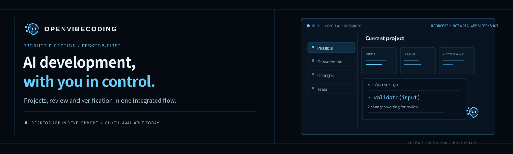

<p align="center"></p>

<p align="center">
  <strong>A terminal workspace for real development work.</strong><br>
  Inspect projects. Review changes. Run tests. Keep the evidence.
</p>

<p align="center">
  <a href="#get-started">Get started</a> ·
  <a href="docs/guide.md">User guide</a> ·
  <a href="docs/security.md">Security boundaries</a> ·
  <a href="docs/automation.md">Computer use</a> ·
  <a href="docs/testing.md">Testing</a>
</p>

---

## Your terminal. Your models. Your approval.

Open Interpreter is a Go/Bubble Tea coding agent with persistent sessions, native provider adapters, reviewed project tools, a shared local runtime, browser QA and desktop integrations.

| Understand | Change | Verify |
| :--- | :--- | :--- |
| Read project instructions, search code and inspect Git | Review unified diffs and approve individual operations | Run tests, inspect exit codes and retain observed results |
| Retrieve earlier evidence and compact long context | Create, replace, move and delete workspace files | Test real websites and inspect screenshots |

### Built to carry the work forward

- **Your choice of model.** Native OpenAI, Anthropic and Gemini protocols; compatible DeepSeek, Kimi, Qwen and local endpoints.
- **One local runtime.** Multiple terminals reuse an authenticated service with coordinated workspace/session execution.
- **Persistent context.** SQLite keeps original conversations, incremental summaries, audit records and usage.
- **Visible control.** File diffs, operation approvals, separate automation/network grants and cancellation.
- **Beyond the terminal.** Playwright workflows and platform desktop backends, with capability detection and OS permission checks.
- **Portable binaries.** Linux, macOS and Windows builds for amd64 and arm64. Both `i` and `interpreter` enter the same application.

## Get started

Build with **Go 1.26.2+**:

```sh
git clone https://github.com/iagoluch/OpenVibeCoding.git
cd OpenVibeCoding
go build -o interpreter ./cmd/interpreter
bash scripts/install.sh ./interpreter
interpreter --credential openai
interpreter --workspace /path/to/project
```

Add `~/.local/bin` to PATH if needed. On Windows, build `interpreter.exe` and use `./scripts/install.ps1 -Binary ./interpreter.exe -AddToPath`, then reopen PowerShell.

Credentials use the OS keychain by default. Environment variables are supported; a restricted local credential file requires explicit opt-in. Run `interpreter --doctor` to inspect setup without exposing keys.

Release download installers and archive/checksum generation are included. **This task has not published a public release**; build locally or use generated archives until one is available. See the [installation and upgrade guide](docs/guide.md#install-and-launch).

## The development loop

```text
❯ Inspect this parser, propose a focused fix, and verify it.

PLAN     Read the implementation and relevant tests.
REVIEW   Inspect the proposed file diff.
APPROVE  Ctrl+Y accepts one operation; Ctrl+N rejects it.
VERIFY   Run the approved command and report its actual result.
```

*Illustrated flow. Actual changes and test results come from your project.*

Enter sends · Ctrl+J adds a newline · Tab completes commands · PgUp/PgDn scroll · Esc cancels.

```text
/model anthropic/claude-sonnet-4-5     /harness inspect
/sessions                            /resume <id>
/context                             /cost
/changes                             /permissions
/capabilities                        /help
```

## Browser and computer use

Enable only the capabilities the task needs:

```sh
interpreter --setup-browser
```

```text
/permissions browser on
/permissions desktop on
/permissions clipboard on
```

Every workflow/action still requires approval. Browser workflows specify authorized origins and interactions; desktop actions use the real visible desktop. Screenshots are transient model evidence and are not saved in session history. Read the [automation contract](docs/automation.md) before enabling desktop input.

| Environment | Execution boundary |
| :--- | :--- |
| Linux | Bubblewrap command isolation; X11 desktop backend. Wayland is unsupported by the built-in backend. |
| macOS | AppleScript/CoreGraphics desktop backend; Accessibility/Screen Recording grants required. |
| Windows | PowerShell/Win32 desktop backend; interactive desktop required; secure/UAC desktops excluded. |

The built-in process sandbox is Linux-only. Required isolation fails closed on unsupported hosts. `--allow-unsandboxed-shell` explicitly enables approved commands with host-user privileges. Details: [security guarantees and limitations](docs/security.md).

## Verification status

**Verified locally:** automated and race tests, protocol fixtures for all three native adapters, shared-runtime auth/concurrency/approval, SQLite/context recovery, real Linux Chromium workflows, Bubblewrap isolation, and real X11 mouse/keyboard/screenshot operations. Six target builds are generated by the packaging script.

**Requires target environments/accounts:** native macOS/Windows execution and desktop/keychain behavior, plus live paid-provider requests. Cross-compilation does not certify native runtime behavior. See the [validation guide](docs/testing.md).

## Explore the project

| Resource | What you'll find |
| :--- | :--- |
| [User guide](docs/guide.md) | Configuration, providers, commands, runtime, installation and removal |
| [Architecture](docs/architecture.md) | Modules, turn lifecycle, persistence and platform responsibilities |
| [Security](docs/security.md) | Actual confinement, approvals, credentials, cancellation and limits |
| [Automation](docs/automation.md) | Browser workflows, desktop action schema and external adapters |
| [Testing](docs/testing.md) | Automated checks, real-provider acceptance and troubleshooting |
| [Presentation website](site/) | Responsive static landing page; ready for GitHub Pages |

```sh
go test -race ./...
go vet ./...
bash scripts/package.sh
```

<p align="center"><sub>An independent terminal coding project. Built around reviewable actions and observed results.</sub></p>
